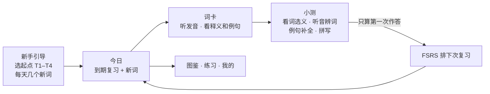
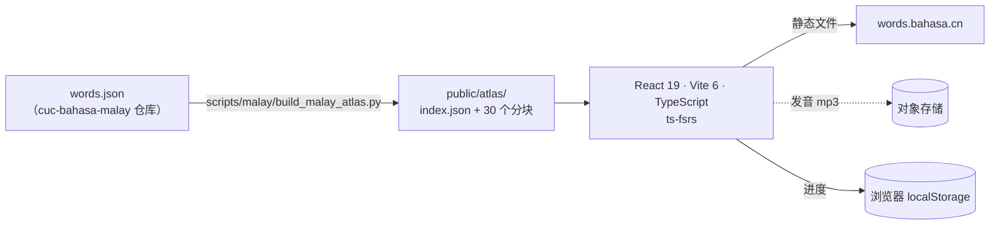

<div align="center">

# JomBelajar · 马来语高频词

**一词一声，学会马来语。**

按频率排好的 2,957 个马来语常用词 · 马来语真人发音 · 中文释义和例句 · FSRS 间隔复习 · 免注册

[**打开网页 ↗**](https://words.bahasa.cn/)　/　[下载词表](data/)　/　[整个项目的架构](https://github.com/roisantoso-id/cuc-bahasa-malay/blob/main/docs/架构.md)

<br>


<table>
<tr>
<td width="33%"></td>
<td width="33%"></td>
<td width="33%"></td>
</tr>
</table>

</div>

---

这是 [JomBelajar](https://github.com/roisantoso-id/cuc-bahasa-malay) 马来语学习项目的网页版背单词。学生不用装小程序、不用登录，打开就能学；进度只存在自己的浏览器里。同一份词表也给微信小程序用。

## 学习流程



- **先听见**：每个词都有马来语真人录音。马来语拼写和读音几乎一一对应，听会了就能写出来。
- **再想起**：选义、听音辨词、例句补全、拼写，从认得走到会写。
- **快忘时重逢**：FSRS（新版 Anki 用的开源记忆算法）在你快要忘记时安排复习。
- **按马来语的规律出题**：例句高亮和挖空认得词缀，`tulis` 能在句子里找到 `menulis`，`anak` 能找到 `anak-anak`，`rumah` 能找到 `rumahnya`。

## 词表

| 项 | 内容 |
|---|---|
| 收录 | 5000 高频词里已审核的第 1–2957 个，其余审完再补 |
| 分级 | T1–T6，按词频每 500 词一段 |
| 分组 | 名词、动词、形容词、副词、功能词、专有名词 |
| 每个词 | 中文释义（可多条）、词性、例句（马来语 + 中文）、词根、发音 |
| 来源 | 启航整理的高频词表，马来语专业团队审核；标了「待复核」的释义不上架 |

下载：[`data/malay-5000.json`](data/malay-5000.json) · [`data/malay-5000.csv`](data/malay-5000.csv)

## 技术



- 纯静态网页，没有后端；词库打包成 JSON 分块按需加载。
- 发音地址由 `index.json` 的 `audioBase` 拼出来，直接从对象存储下载。
- 没有录音时，用设备自带的马来语朗读（`ms-MY`）。

## 本地运行

需要 Node 22+。

```bash
npm install
npm run dev          # http://localhost:5188
npm test             # 单元测试
npm run check:atlas  # 校验词库结构
npm run build        # 输出到 dist/
```

更新词表（需要旁边有 `cuc-bahasa-malay` 仓库）：

```bash
python3 scripts/malay/build_malay_atlas.py ../cuc-bahasa-malay/content/vocab5000/words.json
```

部署：`bash scripts/deploy.sh`。脚本默认连本机 `~/.ssh/config` 里的主机别名 `jombelajar`，仓库里不写服务器地址。

## 目录

| 路径 | 内容 |
|---|---|
| `src/` | 网页代码。`src/lib/text.ts` 是马来语词缀匹配 |
| `public/atlas/` | 网页用的词库分块 |
| `data/` | 可下载的完整词表 |
| `scripts/malay/` | 从 JomBelajar 词表生成词库 |
| `scripts/deploy.sh` | 构建并部署 |
| `scripts/shot-malay.mjs` | 生成 README 截图 |

## 致谢和授权

界面和学习流程改编自开源项目 [词光 Word Atlas](https://github.com/designfuchen/word-atlas)，感谢原作者。原版说明保留在 [README.word-atlas.md](README.word-atlas.md)，`docs/` 下的英文文档和图片也来自原版。

- 代码：MIT（见 [LICENSE](LICENSE)，保留原作者版权声明）
- 马来语词表、释义和例句：JomBelajar 团队

本仓库公开，不包含任何密钥、密码或服务器地址。发现安全问题请私下联系维护者。
